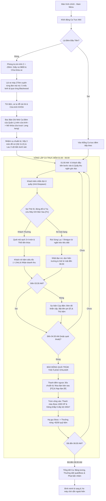

# 📑 TÀI LIỆU ĐẶC TẢ TÍNH NĂNG VÀ LUỒNG GAME (GAME FEATURE DOCUMENT - GFD)
## DỰ ÁN: MIDNIGHT MART - CA TRỰC ĐÊM KINH HOÀNG

> **Tài liệu này đặc tả chi tiết:** Luồng trải nghiệm người chơi (Game Flow States), hành vi cụ thể của từng tính năng (Feature Specifications), các điều kiện kích hoạt, tín hiệu âm thanh/hình ảnh và các trường hợp biên (Edge Cases).

---

## 1. SƠ ĐỒ LUỒNG TRẢI NGHIỆM TỔNG THỂ (GAME FLOW DIAGRAM)

---

## 2. ĐẶC TẢ CHI TIẾT TỪNG TÍNH NĂNG (FEATURE SPECIFICATIONS)

---

### FEATURE 00: PHÂN ĐOẠN KHỞI ĐẦU & CHUYẾN XE MÁY 270M ĐÊM MÙ
- **Tên tính năng:** `Apartment Prologue & 270m Pitch-Black Forest Ride`.
- **Mục tiêu:** Tạo nhịp đệm tâm lý cô độc, nghẹt thở, thiết lập động cơ kiếm tiền ($800 nợ) và tạo sự chuyển giao không gian chân thật từ nhà đến nơi làm việc.
- **Hành vi cụ thể:**
  1. **Căn hộ người chơi ($Z = -294.0\text{m}$):**
     - Phòng trọ kín khít 100%, không còn khe hở tường.
     - Tờ giấy đòi nợ tiền nhà $\$800$, điện thoại nhận tin nhắn tuyển dụng từ Quản lý, chùm chìa khóa xe máy trên bàn làm việc.
     - Cửa phòng mở xoay $75^\circ$ hé lộ khoảng sân hiên nơi chiếc xe máy cũ đang dựng sẵn.
  2. **Cung đường rừng cong 270m ($Z \in [-280.0\text{m}, -10.0\text{m}]$):**
     - **Bầu không khí tối đen tuyệt đối (Pitch-Black):** Zero Ambient Light, Directional Light bị ngắt hoàn toàn, sương mù hàm mũ dày đặc (`density = 0.040`). Ánh sáng duy nhất bên ngoài là luồng đèn pha xe máy (Spotlight 280f, góc 40°, tầm 24m) và các cột đèn đường chao đảo.
     - Đường cong chữ S đôi mềm mại xuyên qua hơn 100 cây thông u ám. Xe tự động ôm cua, người chơi dùng `[W]` để ga và `[A]`/`[D]` để lách xe sang hai bên tim đường.
     - **5 Điểm mốc kinh dị dọc đường:**
       - $Z = -255\text{m}$: Biển gỗ cảnh báo khu rừng cấm bị cào máu sâu hoắm.
       - $Z = -210\text{m}$: Biển báo tam giác vàng *"CẨN THẬN: QUÁI VẬT BĂNG ĐƯỜNG"*.
       - $Z = -165\text{m}$: Bù nhìn cành cây ma quái (Totem) đứng lấp ló trong rừng với đôi mắt đỏ rực le lói nhìn trừng trừng theo xe.
       - $Z = -125\text{m}$: Khúc cua gắt với xe tuần tra cảnh sát lật nghiêng dưới mương, đèn ưu tiên màu cam chớp nháy cô độc.
       - $Z = -80\text{m}$: Biển chào Hạt Blackwood bị gạch xóa vẽ đè bằng máu thành $4,118$...
  3. **Đỗ xe tại siêu thị:** Xe máy tự động giảm tốc tấp vào vỉa hè ($Z \sim -8.5\text{m}$), người chơi xuống xe đi bộ lên hiên tiệm.

---

### FEATURE 00B: BẢN GHI NHỚ CỦA QUẢN LÝ & NHIỆM VỤ CHUẨN BỊ CA TRỰC
- **Tên tính năng:** `Boss Door Memo & Pre-Shift Cleaning Tasks`.
- **Hành vi cụ thể:**
  1. **Bản Ghi Nhớ Cửa Kính (Boss Door Memo):**
     - Cửa kính tự động mặc định bị KHÓA chặt (`_isLocked = true`).
     - Tờ giấy note màu vàng dán trên khung kính cửa trước.
     - Người chơi tiến lại nhấn `[E]` để đọc: Nội dung giải thích sự mất tích của David, giao 2 nhiệm vụ dọn dẹp trước 01:00 AM, cảnh báo quái vật không bóng đổ và hướng dẫn dùng máy tính bàn sau.
     - Đọc xong: Khóa chốt mở, hai cánh cửa kính tự động trượt cuốn sang 2 bên êm ái, chuông cửa vang lên: **Leng Keng!**
  2. **Nhiệm vụ 1: Xếp 3 món đồ rơi vãi lên kệ (0/3):**
     - Nhặt *Gói bánh Snack Đỏ* xếp vào Kệ 3 ($X = -1.5\text{m}$).
     - Nhặt *Chai nước ngọt Xanh* xếp vào Kệ 4 ($X = 1.5\text{m}$).
     - Nhặt *Hộp ngũ cốc Vàng* xếp vào Kệ 5 ($X = 4.5\text{m}$).
     - Hàng xếp vào ô trống vừa khít sau gờ chắn, không đè lên hàng có sẵn.
  3. **Nhiệm vụ 2: Lau 3 vệt bẩn sẫm màu dưới sàn (0/3):**
     - Dùng cây lau nhà tại xô nước góc trước tiệm hoặc nhấn `[E]` vào từng vết bẩn.
     - 3 Vệt bẩn: Gần lối vào cửa chính ($Z = 0.8\text{m}$), lối đi giữa Kệ 2-3 ($X = -3.0\text{m}$), lối đi bên phải giữa Kệ 4-5 ($X = 3.0\text{m}$).
     - Vệt bẩn phát tiếng chà sàn sột soạt, co nhỏ dần và biến mất.
  4. **Chuyển tiếp:** Khi cả hai đạt $3/3$, chuông đồng hồ điểm **01:00 AM**, mở khóa vị khách đầu tiên.

---

### FEATURE 01: KHÔNG GIAN SIÊU THỊ 440M² VỚI 6 DÃY KỆ HÀNG GONDOLA
- **Tên tính năng:** `Supermarket 440m² Layout & 6 Gondola Aisles`.
- **Hành vi cụ thể:**
  - Diện tích sàn mở rộng gấp đôi: $22\text{m} \times 20\text{m} = 440\text{m}^2$, trần cao $3.8\text{m}$ với 9 dàn đèn huỳnh quang phân bổ đều.
  - **6 Dãy kệ hàng Gondola phân bổ đều đặn:**
    - Tọa độ trục X: $X = -7.5\text{m}, -4.5\text{m}, -1.5\text{m}, 1.5\text{m}, 4.5\text{m}, 7.5\text{m}$.
    - Chiều dài mỗi kệ $7.2\text{m}$, rộng $0.9\text{m}$.
    - Lối đi giữa các kệ rộng **$2.1\text{m}$** cực kỳ thoáng đãng, cân xứng hai bên, tối ưu cho góc nhìn FPS và thả diều Boss.
    - Mép ngoài mỗi tầng mâm có **thanh gờ chắn kim loại cao 6cm** kèm nẹp bảng giá, giữ hàng hóa chắc chắn chống rung đổ.
  - **Dãy 6 tủ mát nước ngọt (Drink Coolers):** Trải dọc tường phải ($X = 10.75\text{m}$), phát ánh sáng neon xanh dương ma mị.

---

### FEATURE 02: BÀN NHÂN VIÊN PHÍA SAU & MÁY TÍNH CỬA HÀNG (BACK STAFF TERMINAL)
- **Tên tính năng:** `Back Staff Desk & Store Computer Terminal`.
- **Hành vi cụ thể:**
  1. **Bố trí Bàn Sau Quầy (`Back_Staff_Desk` tại $X = -4.3\text{m}, Z = -3.2\text{m}$):**
     - Kê sát tường sau quầy thu ngân, có đèn bàn chiếu sáng và thùng case PC dưới chân bàn.
     - Quầy thu ngân phía trước hoàn toàn sạch sẽ, chỉ để máy tính tiền, máy quét mã vạch và khay thanh toán.
  2. **Trạm Máy tính Midnight Mart OS v2.4:**
     - Người chơi tiến lại nhấn `[E]` để sử dụng (mở khóa chuột, dùng `[ESC]` hoặc `[E]` để thoát, có debounce 0.35s chống đóng nhầm).
     - Hỗ trợ đầy đủ EventSystem và InputSystemUIInputModule cho New Input System.
     - **Tab 1: CSDL Tra cứu Công dân (`[F1]` / `[1]`):** Tự động đồng bộ hồ sơ khách đang đứng trước quầy. Phát hiện đối tượng dị biến có mã số tử vong, năm sinh bất thường và ra lệnh tiêu diệt.
     - **Tab 2: Cửa hàng Tiếp tế Đêm (`[F2]` / `[2]`):**
       - Gói Đạn 9mm ($\$15$): +10 viên đạn súng lục.
       - Hộp Đạn Shotgun ($\$30$): +4 viên đạn 12-Gauge.
       - Nước Tăng Lực ($\$12$): Hồi phục $100\%$ thể lực Sprint.
       - Thanh Gỗ Chặn Cửa ($\$25$): Gia cố phòng thủ.
       - Tự động trừ tiền quỹ tiệm theo thời gian thực.

---

### FEATURE 03: BÁN HÀNG XÚC GIÁC & QUY TẮC KHÁCH ĐỢI TẠI QUẦY (ANTI-DESPAWN)
- **Tên tính năng:** `Tactile Shopkeeping & Counter Waiting Rule`.
- **Hành vi cụ thể:**
  1. **Khách hàng mang từ 3 - 4 món đồ lên quầy:** Khách đặt dàn hàng ngay ngắn các món hàng kèm Thẻ Căn cước công dân (ID Card).
  2. **Tư thế của Khách:** Đứng tại $X = -1.45\text{m}, Y = 0.0\text{m}, Z = -3.2\text{m}$, hai chân chạm sàn vững vàng, xoay người nhìn trực diện vào thu ngân qua mặt bàn (khắc phục hoàn toàn lỗi quay lưng vào bàn).
  3. **⚠️ Quy tắc Khách kiên nhẫn đợi tại quầy:**
     - Khách **tuyệt đối không bao giờ tự ý biến mất**. Khách kiên nhẫn đợi ở quầy cho đến khi giao dịch hoàn tất hoặc bị nổ súng hạ gục.
     - Khi người chơi đi nghịch lâu (> 18s): Người thật ho nhẹ giục thanh toán; Quái vật Doppelgänger tự động xoay đầu dõi theo bước chân người chơi khắp tiệm (Head Tracking) và thì thầm rùng rợn.
  4. **Lối ra tức thì (~1.9m):** Ngay sau khi thanh toán xong (sau 0.6s), khách quay người bước thẳng ra ngoài cửa trượt tự động (khoảng cách chỉ ~1.9m) và biến mất vào màn đêm, không còn nấn ná ở quầy.

---

### FEATURE 04: NGĂN KÉO BÍ MẬT & TRANG BỊ VŨ KHÍ KHỞI ĐẦU
- **Tên tính năng:** `Secret Drawer & Starter Firearm`.
- **Hành vi cụ thể:**
  - Sau khi phục vụ vị khách đầu tiên, ngăn kéo tiền bị kẹt. Người chơi nhấn `[E]` kéo mạnh bung ngăn kéo.
  - **Điện thoại của David:** Màn hình nhấp nháy tin nhắn cảnh báo quái vật không bóng đổ và hướng dẫn tra cứu máy tính bàn sau.
  - **Khẩu Súng Lục 9mm (Pistol):** Băng đạn 5 viên trong nòng, 15 viên dự trữ (`5 / 15`).
  - Phím `[2]`: Rút / Cất súng. Phím `[R]`: Nạp đạn (1.2s). Chuột trái: Bắn chính xác. Khóa bắn khi hết cả 2 (`0 / 0`).

---

### FEATURE 05: SỰ CỐ CÚP ĐIỆN & ĐÈN KHẨN CẤP (03:30 AM)
- **Tên tính năng:** `Store Power Outage & Siege Event`.
- **Hành vi cụ thể:**
  - 03:30 AM: Toàn bộ 9 dàn đèn huỳnh quang vụt tắt ngúm.
  - Đèn báo động đỏ khẩn cấp trên trần kích hoạt quay tròn tỏa ánh sáng đỏ rực rợn người.
  - Bầy quái vật vây quanh tiệm đập cửa kính. Người chơi bật đèn pin cá nhân `[F]`, thủ quầy và bắn hạ từng con quái tràn vào.
  - Mỗi con quái thoát ra từ các đợt trước sẽ cộng thêm +2 con quái tràn vào đợt này.

---

### FEATURE 06: CUỘC CHẠM TRÁN QUÁI TRÙM ĐÊM 1 (THE FLESH STALKER)
- **Tên tính năng:** `Night 1 Boss Encounter - The Flesh Stalker`.
- **Hành vi cụ thể:**
  - Kích hoạt lúc 04:30 AM (hoặc sớm hơn nếu để kẻ giả mạo trốn thoát).
  - **Thanh Đếm ngược 30 Giây (Countdown Bar):** Màu vàng cam ở đỉnh màn hình: `⚠️ CẢNH BÁO: CON TRÙM ĐANG ĐẾN! CHUẨN BỊ VŨ KHÍ (30s)`. Loa rú còi báo động khẩn cấp, người chơi có 30 giây mua thêm đạn ở máy tính bàn sau và nạp đầy súng.
  - **Trùm Xuất hiện & Thanh Máu Boss:** Cửa kho sau bật tung, Boss khổng lồ cao 2.8m xông vào tiệm gầm vang trời. Thanh máu Boss đồ sộ ở đỉnh màn hình: `THE FLESH STALKER - TRÙM DỊ BIẾN ĐÊM 1 [ 1000 / 1000 HP ]`.
  - **Chiến đấu Kiting FPS trong Không gian 440m²:**
    - 6 dãy kệ hàng Gondola tạo nên các vòng lặp di chuyển (looping routes) hoàn hảo để người chơi luồn lách, chạy nước rút, thả diều và bắn hạ Boss.
    - Hạ gục Boss thưởng nóng **+$200** vào quỹ tiệm và mở khóa kết ca an toàn lúc 06:00 AM.

---

### FEATURE 07: KẾT THÚC CA TRỰC & BÌNH MINH LÓ RẠNG (06:00 AM)
- **Tên tính năng:** `Shift Completion & Dawn Summary`.
- **Hành vi cụ thể:**
  - 06:00 AM: Ánh bình minh le lói xua tan màn sương mù đen ngoài cửa sổ kính.
  - Quản lý bước vào tiệm thanh toán lương: Lương cơ bản $\$300$, thưởng diệt Boss $+\$200$, thưởng diệt quái $+\$50$.
  - Người chơi bước ra cửa, chiếc xe máy cũ đã chờ sẵn dưới nắng sớm. Ca trực đêm kinh hoàng đầu tiên khép lại trong vinh quang!
