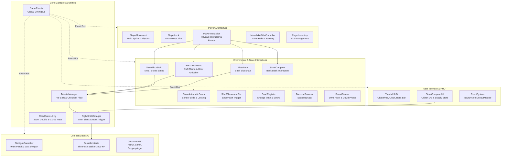

# 🛠️ TÀI LIỆU THIẾT KẾ KỸ THUẬT (TECHNICAL DESIGN DOCUMENT - TDD)
## DỰ ÁN: MIDNIGHT MART - UNITY C# HDRP ARCHITECTURE

> **Mục tiêu tài liệu:** Định nghĩa toàn bộ kiến trúc mã nguồn C#, sơ đồ lớp (Class Diagrams), luồng dữ liệu (Data Flow), tọa độ không gian chính xác, cấu hình New Input System, cơ chế Event Bus và chỉ số ngân sách hiệu năng (Performance Budget) cho dự án.

---

## 1. SƠ ĐỒ KIẾN TRÚC HỆ THỐNG TỔNG THỂ (SYSTEM ARCHITECTURE)

Hệ thống được thiết kế theo nguyên tắc **Decoupled (Khử ghép nối lỏng)** thông qua **Event-Driven Architecture (Kiến trúc Hướng Sự kiện)**:

---

## 2. ĐẶC TẢ TỌA ĐỘ KHÔNG GIAN TOÀN BẢN ĐỒ (WORLD COORDINATE REGISTRY)

| Khu vực / Thực thể | Tọa độ Thế giới ($X, Y, Z$) | Kích thước / Quy chuẩn | Chức năng kỹ thuật |
| :--- | :--- | :--- | :--- |
| **Phòng trọ người chơi (Apt)** | `(0.0f, 0.0f, -294.0f)` | $5\text{m} \times 4\text{m} \times 2.8\text{m}$ | Kín khít 100%, không kẽ hở. Cửa mở xoay $75^\circ$. |
| **Xe máy sân nhà (Home Bike)** | `(0.8f, 0.08f, -288.5f)` | Pitch $-6^\circ$, Yaw $10^\circ$ | Điểm bắt đầu lên xe di chuyển (`MotorbikeMountInteractable`). |
| **Cung đường rừng cong (Road)** | $Z \in [-280.0\text{m}, -10.0\text{m}]$ | Dài $270\text{m}$, rộng $7.0\text{m}$ | Uốn lượn hình chữ S đôi, tối đen tuyệt đối, 5 điểm mốc kinh dị. |
| **Biển cào máu (Landmark 1)** | `(X_road - 4.6f, 0f, -255.0f)` | Biển gỗ $1.8\text{m} \times 1.0\text{m}$ | Vết cào máu sâu hoắm, cảnh báo ranh giới rừng cấm. |
| **Biển quái vật (Landmark 2)** | `(X_road + 4.6f, 0f, -210.0f)` | Biển tam giác vàng xoay $45^\circ$ | Biển phản quang cảnh báo quái vật băng đường. |
| **Bù nhìn ma (Landmark 3)** | `(X_road - 6.5f, 0f, -165.0f)` | Chiều cao $2.5\text{m}$, mắt đỏ | Bù nhìn gỗ với đôi mắt đỏ rực le lói trong rừng. |
| **Xe cảnh sát lật (Landmark 4)**| `(X_road + 5.2f, 0.45f, -125.0f)`| Góc nghiêng $14^\circ$, $22^\circ$, $-14^\circ$| Xe tuần tra lật dưới mương, đèn hazard cam chớp nháy. |
| **Biển chào máu (Landmark 5)** | `(X_road - 4.8f, 0f, -80.0f)` | Biển kim loại $2.0\text{m} \times 1.2\text{m}$ | Dân số bị gạch xóa vẽ đè bằng máu thành $4,118$. |
| **Điểm đỗ xe siêu thị** | `(-2.2f, 0.1f, -7.5f)` | Vỉa hè trước tiệm | Điểm tự động giảm tốc và đỗ xe máy khi đến nơi. |
| **Cửa kính tự động & Ghi nhớ** | `(0.0f, 1.85f, -5.0f)` | Khung $22\text{m}$, cửa mở $2.3\text{m}$ | `BossDoorMemo` dán trên tường bê tông trái (`-1.55f, 1.65f, -5.11f`); mở khóa cửa trượt 2 bên. |
| **Cây lau nhà & Xô nước** | `(4.2f, 0.0f, -3.8f)` | Xô vàng, cán chổi kim loại | Đặt ở góc trước phải tiệm (cách xa cửa & note), nhặt vào kho đồ Ô 1. |
| **Sàn siêu thị Midnight Mart** | `(0.0f, 0.0f, 5.0f)` | $22\text{m} \times 20\text{m} = 440\text{m}^2$ | Trần cao $3.8\text{m}$, 9 đèn tuýp huỳnh quang phân bổ đều. |
| **6 Dãy kệ hàng Gondola** | $X \in \{-7.5, -4.5, -1.5, 1.5, 4.5, 7.5\}$ | Dài $7.2\text{m}$, rộng $0.9\text{m}$ | Lối đi giữa các kệ rộng **$2.1\text{m}$**, gờ chắn mép cao 6cm. |
| **Quầy Thu ngân Phía Trước** | `(-2.4f, 0.5f, -3.2f)` | Bàn dọc $0.95\text{m} \times 2.7\text{m}$ | Máy tính tiền, máy quét mã vạch, khay đặt hàng, ngăn kéo súng. |
| **Bàn Nhân Viên Sau Quầy** | `(-4.3f, 0.5f, -3.2f)` | Bàn làm việc $0.85\text{m} \times 1.6\text{m}$ | Đèn bàn amber, case PC và màn hình trạm máy tính cửa hàng. |
| **Vị trí khách chờ thanh toán**| `(-1.45f, 0.0f, -3.2f)` | Chân chạm sàn $Y = 0$ | Khách nhìn trực diện vào thu ngân (+X), cách cửa tiệm ~1.9m. |
| **Boss Spawn (Cửa kho sau)** | `(0.0f, 0.0f, 14.0f)` | Cửa kho $1.4\text{m} \times 2.6\text{m}$ | Điểm xuất hiện của quái trùm The Flesh Stalker lúc 04:30 AM. |

---

## 3. CÁC LỚP MÃ NGUỒN CỐT LÕI (CORE CLASSES SPECIFICATION)

### 3.1. `BossDoorMemo.cs` (Bản Ghi Nhớ Ca Đêm Trên Cửa Kính)
- **Namespace:** `MidnightMart.Interactions`
- **Interfaces:** `IInteractable`
- **Fields:**
  - `_storeDoors: StoreAutomaticDoors`
  - `_tutorialManager: TutorialManager`
  - `_audioSource: AudioSource`
  - `_paperRustleClip: AudioClip`
  - `_hasBeenRead: bool`
- **Methods:**
  - `GetInteractionPrompt()`: Trả về `"[E] Đọc Bản Hướng Dẫn Ca Đêm Của Quản Lý (Dán trên cửa)"`.
  - `OnInteract(Transform playerTransform)`:
    - Phát âm thanh lật giấy.
    - Gọi `GameEvents.TriggerSubtitle("Bản ghi nhớ Quản lý", memoContent, 10.0f)`.
    - Gọi `_storeDoors.UnlockDoors()` -> mở khóa cửa trượt.
    - Gọi `_tutorialManager.ReportBossMemoRead()` -> chuyển sang nhiệm vụ dọn dẹp & lau sàn.

---

### 3.2. `StoreCleaningMop.cs` (Cây Lau Nhà Đặt Trong Xô)
- **Namespace:** `MidnightMart.Interactions`
- **Interfaces:** `IInteractable`
- **Fields:**
  - `_isPickedUp: bool`
  - `_pickupAudio: AudioClip`
- **Methods:**
  - `GetInteractionPrompt()`: Trả về `"[E] Cầm Cây Lau Nhà"`.
  - `OnInteract(Transform playerTransform)`:
    - Ẩn mô hình cán lau nhà trong xô nước.
    - Gọi `TutorialManager.Instance.ReportCleaningMopPickedUp()`.
    - Kích hoạt trạng thái cầm chổi trên người chơi để đủ điều kiện lau các vết bẩn.

---

### 3.3. `StoreFloorStain.cs` (Vết Bẩn Sẫm Màu Dưới Sàn)
- **Namespace:** `MidnightMart.Interactions`
- **Interfaces:** `IInteractable`
- **Fields:**
  - `_isCleaned: bool`
  - `_audioSource: AudioSource`
  - `_mopClip: AudioClip`
  - `_highlighter: InteractionHighlighter`
- **Methods:**
  - `GetInteractionPrompt()`: Kiểm tra `TutorialManager.Instance.HasCleaningMop`. Nếu chưa có: `"[!] Cần nhặt Cây Lau Nhà ở góc cửa trước để lau sàn"`. Nếu đã có: `"[E] Dùng Cây lau nhà chà sạch vết bẩn"`.
  - `CanInteract()`: Trả về `false` nếu người chơi chưa nhặt cây lau nhà.
  - `OnInteract(Transform playerTransform)`:
    - Chạy Coroutine `CleanStainRoutine()`: phát âm thanh chà sàn, thu nhỏ scale về 0 trong 0.6s.
    - Gọi `TutorialManager.Instance.ReportStainCleaned()`.

---

### 3.3. `StoreAutomaticDoors.cs` (Cửa Kính Trượt Cảm Ứng 2 Cánh)
- **Namespace:** `MidnightMart.Interactions`
- **Fields:**
  - `_leftDoorPanel: Transform`
  - `_rightDoorPanel: Transform`
  - `_slideDistance: float = 1.15f`
  - `_slideSpeed: float = 3.5f`
  - `_sensorDistance: float = 3.2f`
  - `_isLocked: bool = true` (Mặc định bị khóa cho đến khi đọc Boss Memo)
  - `_doorChimeClip: AudioClip`
- **Methods:**
  - `UnlockDoors()`: Đặt `_isLocked = false`, cho phép cảm biến chuyển động hoạt động.
  - `SetLocked(bool locked)`: Khóa hoặc mở khóa thủ công.
  - `Update()`: Nếu `_isLocked == true`, luôn giữ cửa đóng. Nếu mở khóa, quét cự ly người chơi/khách hàng trong phạm vi `_sensorDistance` để trượt cánh trái sang $-X$ và cánh phải sang $+X$.

---

### 3.4. `TutorialManager.cs` (Quản Lý Chuỗi Nhiệm Vụ Mở Đầu)
- **Namespace:** `MidnightMart.Tutorial`
- **Phân kỳ trạng thái (TutorialStep Enum):**
  1. `ReadBossMemo`: Bắt buộc đọc giấy note trên cửa kính.
  2. `PrepareShift`: Dọn dẹp sàn tiệm (Xếp 3 món đồ rơi & Lau 3 vệt bẩn).
  3. `ServeFirstCustomer`: Đón khách Arthur Morgan lúc 01:00 AM.
  4. `InspectAndScan`: Soi thẻ ID & Quét mã vạch 3 món hàng.
  5. `CashPayment`: Mở máy tính tiền & Thối tiền.
  6. `UnlockSecretDrawer`: Mở ngăn kéo bí mật lấy súng 9mm và điện thoại David.
  7. `Completed`: Kết thúc phần hướng dẫn, chuyển giao cho `NightShiftManager`.
- **Hệ thống theo dõi chuẩn bị ca trực kép:**
  - `_totalMessCount = 3`, `_currentMessCleaned: int`
  - `_totalStainsCount = 3`, `_currentStainsCleaned: int`
  - `UpdatePreparationObjectiveText()`:
    - Hiển thị HUD: `MỤC TIÊU: Chuẩn bị ca trực - Xếp đồ rơi ({_currentMessCleaned}/3) & Lau vệt bẩn ({_currentStainsCleaned}/3)`
    - Chỉ kích hoạt `ServeFirstCustomer` khi cả hai đều đạt $3/3$.

---

### 3.5. `StoreComputerUI.cs` (Giao Diện Máy Tính Bàn Sau)
- **Namespace:** `MidnightMart.UI`
- **Kiến trúc phân tách chống Deactivation:**
  - GameObject Root (`Store_Computer_Terminal_UI`) luôn ở trạng thái **Active** để lắng nghe sự kiện `GameEvents.OnStoreComputerToggled`.
  - Toàn bộ giao diện hiển thị nằm trong GameObject con `Computer_Window_Panel` (`_mainPanel`), được ẩn/hiện độc lập.
  - Tích hợp `EventSystem` và `InputSystemUIInputModule` đảm bảo mọi nút bấm trên Canvas nhận sự kiện chuột chính xác 100%.
- **Chống đóng nhầm bằng Debounce:**
  - Ghi nhận `_openTimestamp = Time.unscaledTime` khi mở máy tính.
  - Trong $0.35$ giây đầu tiên, chặn phím `[E]` đóng máy tính (tránh xung đột frame người chơi nhấn `[E]` vào máy tính 3D).
  - Hỗ trợ phím tắt `[ESC]` hoặc `[E]` để thoát, `[F1]` / `[1]` cho Tab CSDL, `[F2]` / `[2]` cho Tab Tiếp tế.
- **Tích hợp trừ ngân sách:**
  - Gọi `NightShiftManager.Instance.DeductMoney(cost)` để trừ tiền quỹ tiệm thật khi mua đạn hoặc đồ tiếp tế.

---

### 3.7. `LocalizationManager.cs` & `AudioManager.cs` (Đa Ngôn Ngữ & Quản Lý Âm Thanh)
- **Namespace:** `MidnightMart.Core`
- **`LocalizationManager`:**
  - Hỗ trợ enum `GameLanguage`: `Vietnamese` (Mặc định) và `English`.
  - Lưu và tải cấu hình người chơi qua `PlayerPrefs` (`KEY_LANG`).
  - Sự kiện toàn cục `OnLanguageChanged` kích hoạt cập nhật văn bản tức thì trên toàn bộ HUD, menu và phụ đề.
  - Cung cấp hàm tiện ích tĩnh `LocalizationManager.T(vi, en)` cho phép viết code song ngữ gọn gàng, 0 GC overhead.
- **`AudioManager`:**
  - Quản lý 3 kênh âm lượng: `MasterVolume`, `SFXVolume` (môi trường, súng đạn, bước chân, tương tác), và `MusicVolume` (BGM).
  - Tự động đồng bộ và cập nhật runtime cho toàn bộ `AudioSource` đã đăng ký qua `RegisterSFXSource` / `RegisterMusicSource`.
  - Lưu trữ giá trị âm lượng qua `PlayerPrefs`.

---

### 3.8. `PauseSettingsUI.cs` (Menu Cài Đặt & Tạm Dừng Game)
- **Namespace:** `MidnightMart.UI`
- **Tương tác kích hoạt:**
  - Lắng nghe phím `[ESC]` và `[P]` (New Input System `Keyboard.current`).
  - Lắng nghe sự kiện click từ nút bánh răng trên HUD (`HUD_Pause_Gear_Button`).
  - Tự động bỏ qua nếu giao diện máy tính quầy thu ngân đang mở để tránh xung đột frame.
- **Đóng băng game an toàn:**
  - Khi mở: `Time.timeScale = 0f`, `Cursor.lockState = CursorLockMode.None`, `Cursor.visible = true`.
  - Khi đóng: `Time.timeScale = 1f`, `Cursor.lockState = CursorLockMode.Locked`, `Cursor.visible = false`.
- **Giao diện Song ngữ & Slider Âm thanh:**
  - 2 nút lựa chọn ngôn ngữ: `[🇻🇳 Tiếng Việt]` và `[🇬🇧 English]` với hiệu ứng highlight trực quan màu xanh/xám.
  - 2 thanh trượt Slider `_sfxSlider` và `_musicSlider` kèm Text hiển thị phần trăm âm lượng thực tế ($0\% - 100\%$).
  - 3 nút hành động: Tiếp tục chơi [ESC], Chơi lại ca trực (`SceneManager.LoadScene`), Thoát game (`Application.Quit`).

---

### 3.9. Vòng Lặp Trở Về Nhà & Chuyển Sang Ngày 2 (Day 1 -> Day 2 Transition Cycle)
- **`ReturnMotorbikeMountInteractable.cs`:**
  - Gắn trên chiếc xe máy dựng ngoài vỉa hè tiệm (`Return_Motorbike_Prop`).
  - Kích hoạt sau khi người chơi nhấn `[Space]` đóng bảng tổng kết ca 06:00 AM.
  - Nhấn `[E]` gọi `NightShiftManager.Instance.StartReturnHomeRide()` -> kích hoạt `MotorbikeRideController.StartMotorbikeRideReturnHome()`.
- **Chuyến chạy xe máy chiều về (`MotorbikeRideController.cs`):**
  - Chuyển `_isReturnTrip = true`.
  - Vị trí bắt đầu: $Z = -8.0\text{m}$, hướng quay $180^\circ$ (quay về Nam, Z giảm dần về $-280\text{m}$).
  - Cập nhật tiếp tuyến góc cua: $\text{targetYaw} = 180^\circ - \text{roadTangentAngle} - \text{steerInput} \cdot 5.0^\circ$.
  - Khi đến $Z \le -276.0\text{m}$, xe tự động tấp vào hiên phòng trọ $Z = -282.0\text{m}$, tắt máy, người chơi xuống xe và phòng trọ kích hoạt trở lại.
- **`ApartmentBedInteractable.cs`:**
  - Gắn trên giường ngủ căn hộ (`Bed`).
  - `CanInteract()` kiểm tra điều kiện trở về nhà sau ca trực (`PlayerHomeManager.Instance.CanSleepForDay2`).
  - `OnInteract()` kích hoạt `PlayerHomeManager.Instance.GoToSleepForDay2()`:
    - Mờ màn hình (Fade to black).
    - Hiển thị phụ đề chuyển cảnh ác mộng tâm lý.
    - Kích hoạt sự kiện `GameEvents.TriggerDayAdvanced(2)`.
    - Gọi `NightShiftManager.Instance.AdvanceToDay(2)`.
    - Đặt người chơi đứng dậy cạnh giường lúc **11:30 PM**, chuông báo thức reo vang chuẩn bị ca trực Ngày 2.

---

### 3.10. Cấu hình Chiếu sáng Đêm Cân Bằng & Giao Diện Kích Thước Gấp Đôi
- **Chiếu sáng Ngoại cảnh U Ám (Eerie Night):**
  - Cố định HDRP Fixed Exposure tại **2.2 EV** (thay vì 5.4 EV quá tối): Tăng độ nhạy sáng lên ~9 lần, giúp mắt người chơi nhìn rõ cảnh quan cây cối, mặt đường và các biển báo dọc đường mà không bị tối om mù mịt, trong khi vẫn giữ trọn không khí đêm huyền bí.
  - **Ánh trăng lạnh dịu nhẹ (Moonlight Directional Light):** Bổ sung Directional Light màu xanh bạc rùng rợn `(0.38, 0.48, 0.72)`, cường độ `1.8 lux`, góc nghiêng $58^\circ$, tạo bóng đổ mềm mại cho rừng cây.
  - **14 Cột đèn đường dạng Cần Vươn (Overhead Cantilever Downlights):**
    - Cần đèn vươn ngang 2.6m ra phía trên làn đường di chuyển.
    - **Spot Light CHIẾU THẲNG ĐỨNG XUỐNG MẶT ĐƯỜNG (Downlight - Rotation = 90°, 0°, 0°):** Tầm xa 22m, góc rọi 68°, cường độ cực mạnh **6,500f**, góc nón trong 38°, tạo thành từng vệt sáng tròn vàng rực rỡ trực tiếp trên mặt đường nhựa ngay tâm làn xe chạy.
    - Cấu trúc GameObject Root tỷ lệ chuẩn 1:1, ngăn ngừa méo nón sáng Spot Light và đặt chao đèn chuẩn xác 1.7m vào làn đường.
    - **TUYỆT ĐỐI KHÔNG DÙNG ĐÈN SÁNG TỎA (Point Light):** Loại bỏ triệt để quầng sáng tỏa đa hướng để tránh làm sáng bệt không gian xung quanh.
    - Mặt kính phát sáng vàng rực (`Mat_StreetLampBulbGlow`) gắn dưới đáy chao đèn.
  - **Đèn pha xe máy & Đèn pin cá nhân:** Nâng cấp tầm quét đèn pha lên 55m (4,500f, góc 50°) và đèn pin lên 30m (2,800f, góc 48°).
  - **Bản Ghi Nhớ Ca Đêm (Boss Door Memo):** Đặt tại $X = -1.55\text{m}, Y = 1.65\text{m}, Z = -5.11\text{m}$ trên tường đặc bên trái cửa (`Storefront_Solid_Wall_Left`), dán băng keo nẹp chắc chắn, 100% không bị bay lơ lửng khi cửa tự động trượt mở.
- **Giao Diện Chữ To Gấp Đôi & Panel Đen Co Dãn:**
  - Objective Panel: $760 \times 58\,\text{px}$, cỡ chữ 24pt bold.
  - Clock & Money Badge: $400 \times 58\,\text{px}$, cỡ chữ 24pt bold.
  - Prompt Badge: $720 \times 68\,\text{px}$, cỡ chữ 24pt bold, vị trí $(0, -70)$.
  - Inventory Bar: $310 \times 96\,\text{px}$, 3 ô slot $90 \times 90\,\text{px}$, cỡ chữ 17pt bold (Dynamic Inventory linh hoạt: món nhặt trước ở ô 1, các món sau lần lượt).
  - Subtitle Banner: $1320 \times 240\,\text{px}$, vị trí $(0, 105)$, người nói 26pt bold, nội dung 22-26pt (auto-sizing), prompt 20pt bold.
  - Ammo Badge: $160 \times 54\,\text{px}$, cỡ chữ 28pt bold.
  - Summary Panel: $980 \times 580\,\text{px}$, cỡ chữ 24pt.
  - Boss Countdown: $860 \times 65\,\text{px}$, cỡ chữ 24pt bold.
  - Boss Health Bar: $920 \times 85\,\text{px}$, cỡ chữ 22pt bold.

---

## 4. BẦU KHÔNG KHÍ ĐÊM TỐI OM & CHIẾN ĐẤU BOSS (GRAPHICS & AI)

### 4.1. Cấu hình Chiếu sáng Đêm tối om (Pitch-Black Night)
- Camera: `clearFlags = SolidColor`, `backgroundColor = Color.black`.
- RenderSettings: `skybox = null`, `ambientMode = Flat`, `ambientLight = Color.black`, `ambientIntensity = 0f`, `reflectionIntensity = 0f`.
- Fog: `fog = true`, `fogMode = ExponentialSquared`, `fogColor = Color.black`, `fogDensity = 0.040f`.
- Directional Light: `enabled = false`, `intensity = 0f`.
- Ngoại cảnh chỉ được chiếu sáng bởi:
  - Đèn pha xe máy: Spotlight `280f`, tầm $24\text{m}$, góc $40^\circ$.
  - 6 Cột đèn đường ven rừng: Point light `250f - 350f`, chao đèn nhấp nháy ngẫu nhiên (`StreetLampFlicker`).
  - Đèn hazard xe cảnh sát lật: Point light amber `100f` chớp nháy nhịp $0.5\text{s}$.

### 4.2. Boss AI (`BossMonsterAI.cs`) & HUD
- Tốc độ di chuyển: $3.0\text{ m/s}$ (truy đuổi trực tiếp người chơi).
- Tầm tấn công cào cấu: $2.4\text{m}$, sát thương $25\text{ DMG/đòn}$, giãn cách $2.0\text{s}$.
- Sinh mệnh: $1000\text{ HP}$.
- Hiển thị HUD:
  - Thanh đếm ngược chuẩn bị 30 giây: `_bossCountdownPanel` hiển thị thanh fill màu cam giảm dần kèm text `⚠️ CẢNH BÁO: CON TRÙM ĐANG ĐẾN! CHUẨN BỊ VŨ KHÍ ({countdown:0}s)`.
  - Thanh máu Boss: `_bossHealthPanel` hiển thị thanh đỏ `THE FLESH STALKER - TRÙM DỊ BIẾN ĐÊM 1 [ {currentHp} / {maxHp} HP ]`.
- Không gian 6 dãy kệ $440\text{m}^2$ cung cấp các đường vòng chạy (looping paths) giúp người chơi duy trì khoảng cách thả diều an toàn, nạp đạn và bắn hạ Boss.
